  📂 <b>Open:</b>
  <a href="https://github.com/Pushkraj-Space/slient-inp-v1">silent-input</a> ·
  <a href="https://github.com/Pushkraj-Space/paperless-print">paperless-print</a> ·
  <a href="https://github.com/Pushkraj-Space/github-ai-commit-reporter">github-ai-commit-reporter</a> ·
  <a href="https://github.com/Pushkraj-Space/db-schema-diff-checker">db-schema-diff-checker</a>

<i>It's now safe to close this tab.</i>

